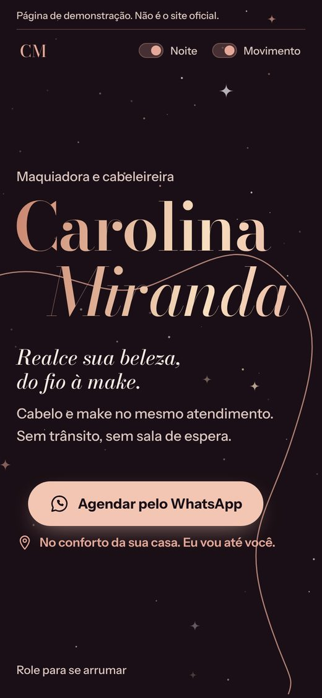
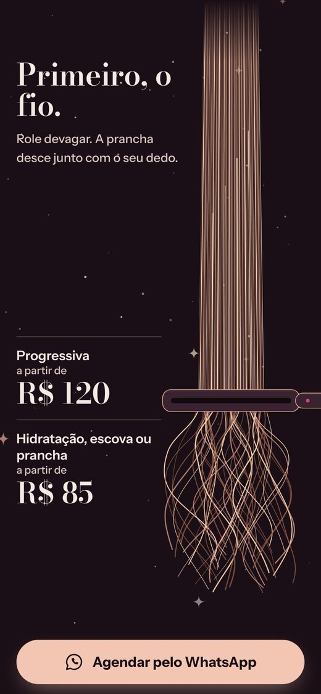
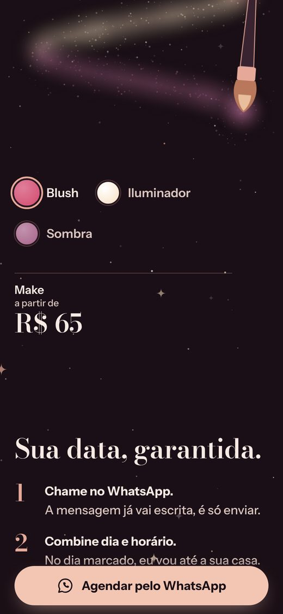

# 💄 Carolina Miranda · Maquiadora e cabeleireira a domicílio

### 🔗 **[Abrir a prévia do site](https://b4sileus-py.github.io/previas-estudio-basileus/carolina-miranda/)**

`https://b4sileus-py.github.io/previas-estudio-basileus/carolina-miranda/`

> ⚠️ **Página de demonstração.** Não é o site oficial da profissional. Foi criada pelo Estúdio Basileus somente com informações que ela mesma divulgou, para mostrar como a página dela poderia ser.

  
  
  

## ✨ A ideia

**"Do fio à make."** A página acompanha o atendimento na mesma ordem em que ele acontece: primeiro o cabelo, depois a maquiagem, e no fim o espelho de camarim se acende. O objetivo é um só: a cliente tocar no botão e chamar no WhatsApp para agendar.

## 👀 O que ver na página

| Parte | O que acontece |
|---|---|
| 🌙 Abertura | O nome dela, a frase que ela usa e o botão de agendar logo de cara |
| 💬 Qual é o seu momento? | A cliente escolhe a ocasião e a mensagem do WhatsApp já sai escrita |
| 💇 O fio | Ao rolar a tela, a prancha desce alisando a mecha e a tesoura apara as pontas |
| 💄 A make | O pincel solta o pó iluminador, com blush, iluminador e sombra |
| 📅 Sua data, garantida | Os passos da reserva e a conta dos 25% feita na hora |
| 🪞 O espelho | As lâmpadas do camarim acendem e o botão de agendar aparece de novo |
| ✉️ Recado para a Carolina | O que falta para a página ficar completa, como as fotos dos trabalhos dela |

## 📱 Como ver melhor

- Abra no **celular**. A página foi desenhada primeiro para ele.
- **Role devagar** na parte do cabelo: a prancha acompanha o seu dedo.
- **Arraste o dedo** pela tela para ver o rastro de luz.
- No topo dá para trocar entre o tema de **noite** e o de **dia**, e para pausar as animações.

## ♿ Cuidados

- Textos com contraste e peso pensados para ler bem na tela pequena.
- Quem prefere menos movimento pode pausar as animações, e a página respeita essa preferência do aparelho.
- Poucos toques até o agendamento: a mensagem já vai pronta, é só enviar.

## 🛠️ Tecnologias

HTML, CSS e JavaScript puros, com GSAP e Lenis para o movimento. As fontes Bodoni Moda e Instrument Sans são livres e ficam na própria pasta.

## 📌 Situação

Página completa, aguardando a conversa com a profissional. Preços, serviços e condições são os que ela publicou e precisam ser confirmados por ela antes de qualquer divulgação.

---

👑 Criado por Roberto Siqueira · Estúdio Basileus · [Ver todas as prévias](../)
