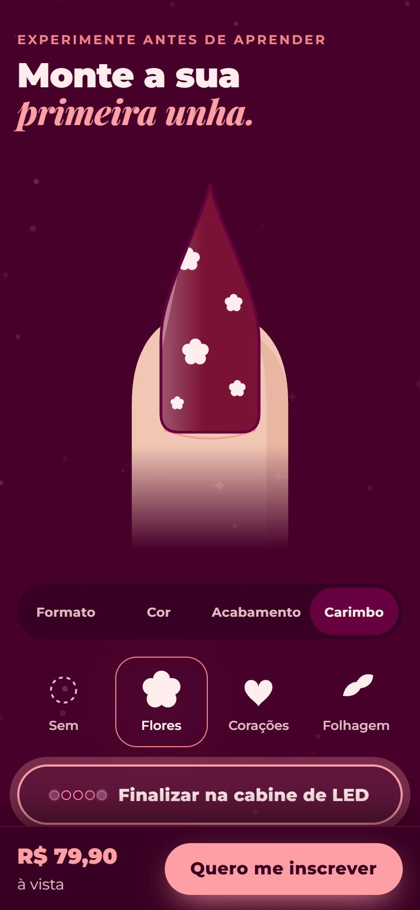
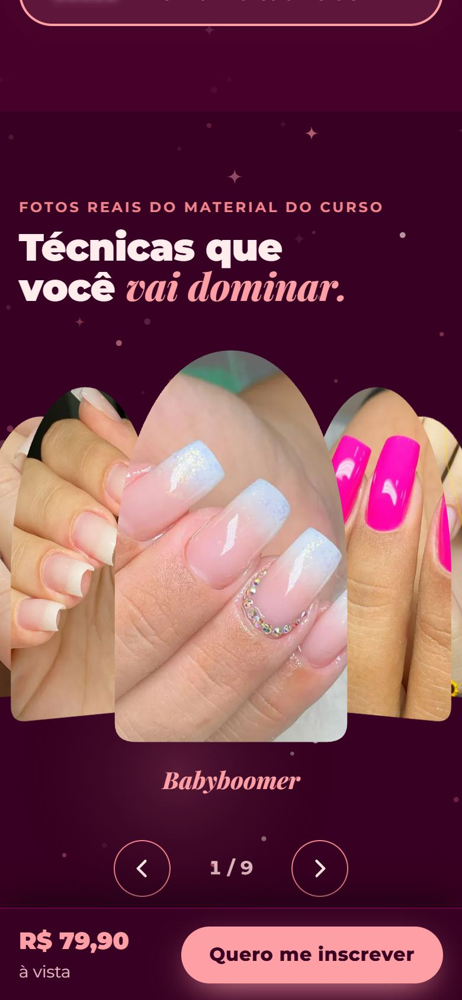

# 💅 Escola Designer de Unhas · Página de afiliado (portfólio)

### 🔗 **[Abrir a página](https://b4sileus-py.github.io/previas-estudio-basileus/escola-designer-unhas/)**

`https://b4sileus-py.github.io/previas-estudio-basileus/escola-designer-unhas/`

> ⚠️ **Página demonstrativa de afiliado.** Experimento do Estúdio Basileus para portfólio. O curso Escola Designer de
> Unhas é de outro produtor e é vendido pela Hotmart. Preço, conteúdo, fotos e comentários de alunas vêm do material de
> divulgação que o produtor fornece aos afiliados. O botão de compra abre uma janela de demonstração.

  
  
  

## ✨ A ideia

**"A unha é a janela."** O formato amendoado da unha é a moldura da página, e a visitante experimenta o curso antes de
comprar: monta a própria unha com as técnicas que vai aprender. Tudo leva a um clique, o botão de compra.

## 👀 O que ver na página

| Parte | O que acontece |
|---|---|
| 🌙 Abertura | Foto de unhas de fundo, "Seja sua própria chefe" e o preço com o botão já na primeira tela |
| 💅 Monte a sua primeira unha | Escolha o formato (a lixa passa), a cor (o gel sobe), o acabamento e o carimbo (ele desce e aperta); no fim, a unha vai para a cabine de LED |
| 🖼️ Técnicas | Galeria em leque com fotos reais, arrastando com o dedo |
| 💸 Paga uma vez | Os 12 meses de salão contra uma parcela única, e a cliente que volta |
| 📅 Agenda cheia | Simulação de ganhos com a agenda do mês enchendo (com aviso de simulação) |
| 💬 Quem fez, aprovou | Comentários de alunas em faixas que correm e param para ler |
| ✨ Purpurina | Glitter que flutua, foge do dedo e deixa um rastro de luz; a assinatura solta fogos |

## 🛠️ Feita com

HTML, CSS e JavaScript, com [GSAP](https://gsap.com) e [Lenis](https://github.com/darkroomengineering/lenis) para o
movimento e um canvas próprio para a purpurina. Respeita "reduzir movimento" e tem uma chave para desligar as animações.

👑 Criado por Roberto Siqueira · Estúdio Basileus
