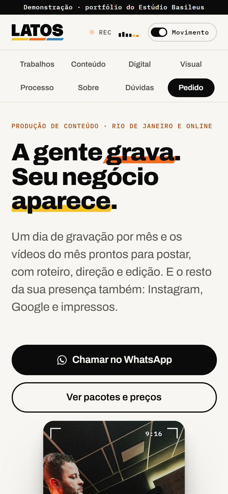
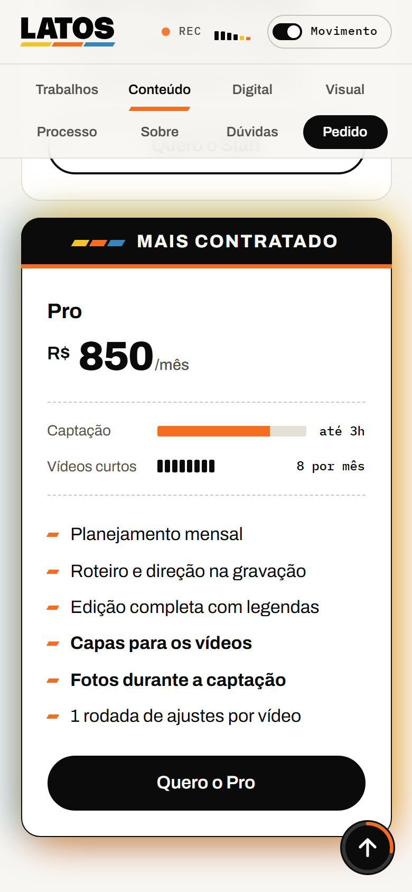
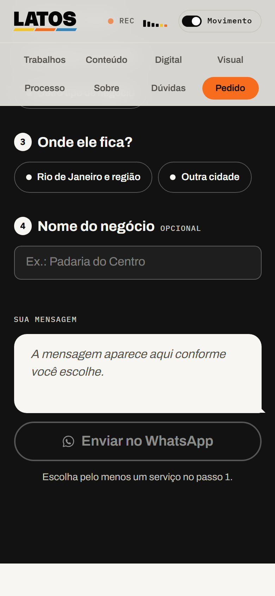

# 🎬 Latos Mídia · Produção de conteúdo (portfólio)

### 🔗 **[Abrir a página](https://b4sileus-py.github.io/previas-estudio-basileus/latos-midia/)**

`https://b4sileus-py.github.io/previas-estudio-basileus/latos-midia/`

> ⚠️ **Página demonstrativa, publicada como portfólio do Estúdio Basileus com autorização da Latos Mídia.** Não é o site
> oficial da empresa. Serviços, preços e contatos vêm do site oficial da Latos; as fotos são trabalhos e bastidores
> cedidos pelo fundador, Roni Santos.

  
  
  

## ✨ A ideia

**"A página é uma ilha de edição."** As três faixas do logo da Latos (amarelo, laranja e azul) saem do topo e viram as
trilhas de uma linha do tempo. Cada cor é uma frente de serviço e guia a pessoa pela página: laranja para Produção de
Conteúdo, azul para Soluções Digitais e amarelo para Comunicação Visual.

## 👀 O que ver na página

| Parte | O que acontece |
|---|---|
| 🎞️ Abertura | As faixas do logo voam até a linha do tempo; o monitor 9:16 troca as fotos do trabalho; dá para arrastar a fita e tocar num clipe |
| 🗂️ Trabalhos | Pastas de filtro como numa ilha de edição e foto ampliada que cresce do lugar tocado |
| 💰 Pacotes e kits | Preços reais, horas de captação e quantidades desenhadas em barras; o destaque tem luz nas cores da marca |
| 🧩 Pedido digital | Escolha um ou mais serviços e mande um pedido só |
| 🎬 Como funciona | A rolagem leva um cabeçote pela trilha e cada cena bate a claquete |
| 💬 Monte seu pedido | Toque nas opções e a mensagem do WhatsApp se escreve sozinha |
| 👑 Assinatura | A claquete bate "Corta!" e as três faixas atravessam o rodapé |

## 🛠️ Feita com

HTML, CSS e JavaScript, com [GSAP](https://gsap.com) e [Lenis](https://github.com/darkroomengineering/lenis) para o
movimento. Respeita "reduzir movimento", tem uma chave para desligar as animações e foi auditada em várias larguras,
no teclado e com leitor de tela.

👑 Criado por Roberto Siqueira · Estúdio Basileus
